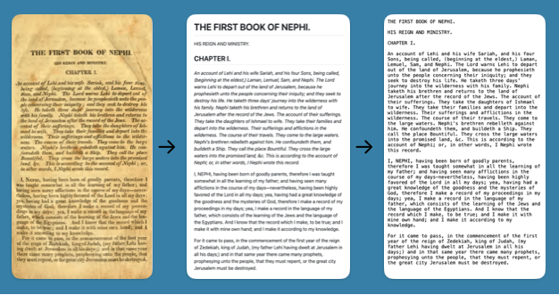

# Latter-day Saint Restoration Documents

Latter-day Saint Restoration Documents is an effort to us AI tools, and tools built by AI, to transcribe the content of digital photographs of original texts from the history of The Church of Jesus Christ of Latter-day Saints into [Markdown](#what-is-markdown) and Plain Text files. 

[Currently available texts](#currently-available-texts) include early editions of _The Book of Mormon_, _The Book of Commandments_, and the _Phinney Cooperstown Bible_. Additional texts will be added over time. 

For AI, so far we used _Claude Code_ by Anthropic, using the _Sonnet 5.5_ Model, configured with _Medium_ effort.

## AI Transcription
Each page of the original text is transcribed using Artificial Intelligence by analyzing the images of each page, and using programming languages and image manipulation tools to zoom in and out to examine words, letters, and punctuation. The AI generates a separate [Markdown](#what-is-markdown) file for each page, with comments identifying features of the page, as well as uncertain words or punctuation. The AI compares its results to OCR extractions of the same text. The AI then runs an agent to blindly proofread each markdown file and compare it to the original image, identifying discrepancies and ambiguities. All of the generated Python tools are included in each text's git repository, as well as all of the AI documentation.

# Files
Once the [Markdown](#what-is-markdown) files for each page have been created, the AI uses code to generate the following output:
* The whole text in a single [Markdown](#what-is-markdown) file
* The whole text in a single plain text file
* A plain text file containing just the core text, excluding frontmatter &c. (called the "sparse" text) 
* A [Markdown](#what-is-markdown) file cataloging printer's typos and errors that can be identified by AI

The sparse text file may be useful for importing into databases or analyzing with other tools.

## Currently Available Texts

* [1830 Edition of The Book of Mormon](https://github.com/lds-restoration-documents/1830-grandin-palmyra-book-of-mormon)
  * [Transcribed Pages](https://github.com/lds-restoration-documents/1830-grandin-palmyra-book-of-mormon/blob/main/book-of-mormon-1830-pages)
  * [book-of-mormon-1830.md](https://github.com/lds-restoration-documents/1830-grandin-palmyra-book-of-mormon/blob/main/book-of-mormon-1830.md)
  * [book-of-mormon-1830.txt](https://github.com/lds-restoration-documents/1830-grandin-palmyra-book-of-mormon/blob/main/book-of-mormon-1830.txt)
  * [book-of-mormon-1830-sparse.txt](https://github.com/lds-restoration-documents/1830-grandin-palmyra-book-of-mormon/blob/main/book-of-mormon-1830-sparse.txt)
  * [printer-typos.md](https://github.com/lds-restoration-documents/1830-grandin-palmyra-book-of-mormon/blob/main/printer-typos.md)
    
* [1837 Edition of The Book of Mormon](https://github.com/lds-restoration-documents/1837-pratt-goodson-kirtland-book-of-mormon)
  * [Transcribed Pages](https://github.com/lds-restoration-documents/1837-pratt-goodson-kirtland-book-of-mormon/blob/main/book-of-mormon-1837-pages)
  * [book-of-mormon-1837.md](https://github.com/lds-restoration-documents/1837-pratt-goodson-kirtland-book-of-mormon/blob/main/book-of-mormon-1837.md)
  * [book-of-mormon-1837.txt](https://github.com/lds-restoration-documents/1837-pratt-goodson-kirtland-book-of-mormon/blob/main/book-of-mormon-1837.txt)
  * [book-of-mormon-1837-sparse.txt](https://github.com/lds-restoration-documents/1837-pratt-goodson-kirtland-book-of-mormon/blob/main/book-of-mormon-1837-sparse.txt)
  * [printer-typos.md](https://github.com/lds-restoration-documents/1837-pratt-goodson-kirtland-book-of-mormon/blob/main/printer-typos.md)

* [1840 Edition of The Book of Mormon](https://github.com/lds-restoration-documents/1840-robinson-smith-nauvoo-book-of-mormon)
  * [Transcribed Pages](https://github.com/lds-restoration-documents/1840-robinson-smith-nauvoo-book-of-mormon/blob/main/book-of-mormon-1840-pages)
  * [book-of-mormon-1840.md](https://github.com/lds-restoration-documents/1840-robinson-smith-nauvoo-book-of-mormon/blob/main/book-of-mormon-1840.md)
  * [book-of-mormon-1840.txt](https://github.com/lds-restoration-documents/1840-robinson-smith-nauvoo-book-of-mormon/blob/main/book-of-mormon-1840.txt)
  * [book-of-mormon-1840-sparse.txt](https://github.com/lds-restoration-documents/1840-robinson-smith-nauvoo-book-of-mormon/blob/main/book-of-mormon-1840-sparse.txt)
  * [printer-typos.md](https://github.com/lds-restoration-documents/1840-robinson-smith-nauvoo-book-of-mormon/blob/main/printer-typos.md)

* [1841 Edition of The Book of Mormon](https://github.com/lds-restoration-documents/1841-young-kimball-pratt-liverpool-book-of-mormon)
  * [Transcribed Pages](https://github.com/lds-restoration-documents/1841-young-kimball-pratt-liverpool-book-of-mormon/blob/main/book-of-mormon-1841-pages)
  * [book-of-mormon-1841.md](https://github.com/lds-restoration-documents/1841-young-kimball-pratt-liverpool-book-of-mormon/blob/main/book-of-mormon-1841.md)
  * [book-of-mormon-1841.txt](https://github.com/lds-restoration-documents/1841-young-kimball-pratt-liverpool-book-of-mormon/blob/main/book-of-mormon-1841.txt)
  * [book-of-mormon-1841-sparse.txt](https://github.com/lds-restoration-documents/1841-young-kimball-pratt-liverpool-book-of-mormon/blob/main/book-of-mormon-1841-sparse.txt)
  * [printers-typos.md](https://github.com/lds-restoration-documents/1841-young-kimball-pratt-liverpool-book-of-mormon/blob/main/printer-typos.md)

* [1833 Book of Commandments](https://github.com/lds-restoration-documents/1833-phelps-zion-book-of-commandments)
  * [Transcribed Pages](https://github.com/lds-restoration-documents/1833-phelps-zion-book-of-commandments/blob/main/book-of-commandments-1833-pages)
  * [book-of-commandments-1833.md](https://github.com/lds-restoration-documents/1833-phelps-zion-book-of-commandments/blob/main/book-of-commandments-1833.md)
  * [book-of-commandments-1833.txt](https://github.com/lds-restoration-documents/1833-phelps-zion-book-of-commandments/blob/main/book-of-commandments-1833.txt)
  * [book-of-commandments-1833-sparse.txt](https://github.com/lds-restoration-documents/1833-phelps-zion-book-of-commandments/blob/main/book-of-commandments-1833-sparse.txt)
  * [printer-typos.md](https://github.com/lds-restoration-documents/1833-phelps-zion-book-of-commandments/blob/main/printer-typos.md)

* [1828 Phinney Cooperstown Bible](https://github.com/lds-restoration-documents/1828-phinney-cooperstown-bible)
  * [Transcribed Pages](https://github.com/lds-restoration-documents/1828-phinney-cooperstown-bible/blob/main/phinney-bible-pages)
  * [phinney-bible.md](https://github.com/lds-restoration-documents/1828-phinney-cooperstown-bible/blob/main/phinney-bible.md)
  * [phinney-bible.txt](https://github.com/lds-restoration-documents/1828-phinney-cooperstown-bible/blob/main/phinney-bible.txt)
  * [phinney-bible-sparse.txt](https://github.com/lds-restoration-documents/1828-phinney-cooperstown-bible/blob/main/phinney-bible-sparse.txt)
  * [printer-typos.md](https://github.com/lds-restoration-documents/1828-phinney-cooperstown-bible/blob/main/printer-typos.md)

## What is Markdown?
Markdown is a simple way of writing formatted text using plain characters, such as `#` for headings and `*asterisks*` for *italics*. A Markdown file is still readable as ordinary text, and can also be displayed with formatting. 
* Learn more at [markdown.org](https://markdown.org/).
* Tools for displaying, editing, or converting Markdown files: [https://markdown.org/tools/](https://markdown.org/tools/)

## Disclaimer
This is an individual personal project and is not officially affiliated with [The Church of Jesus Christ of Latter-day Saints](https://www.churchofjesuschrist.org/).
